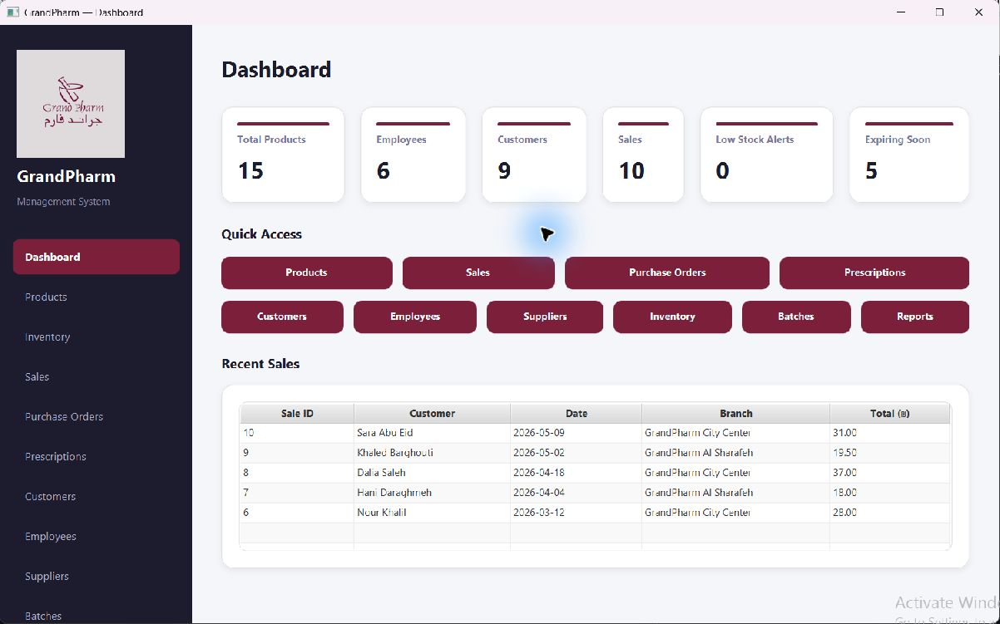
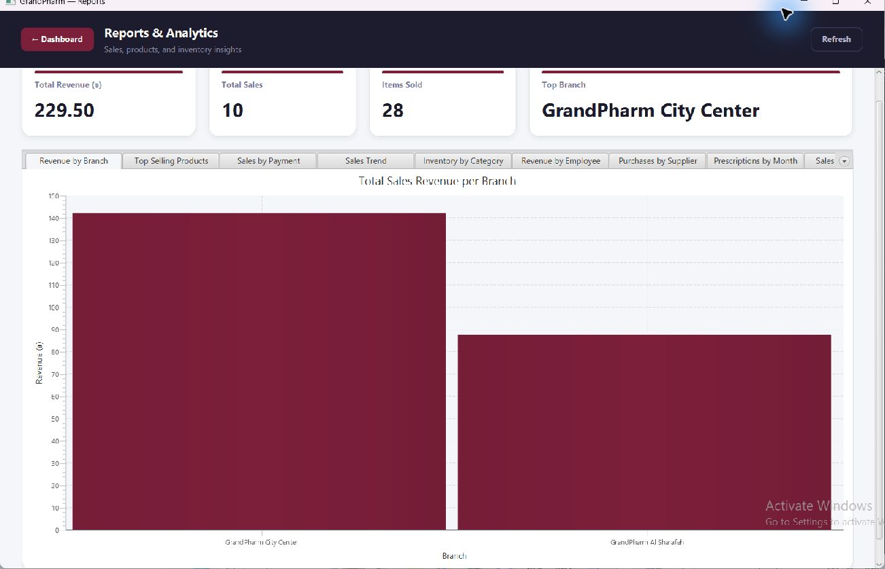
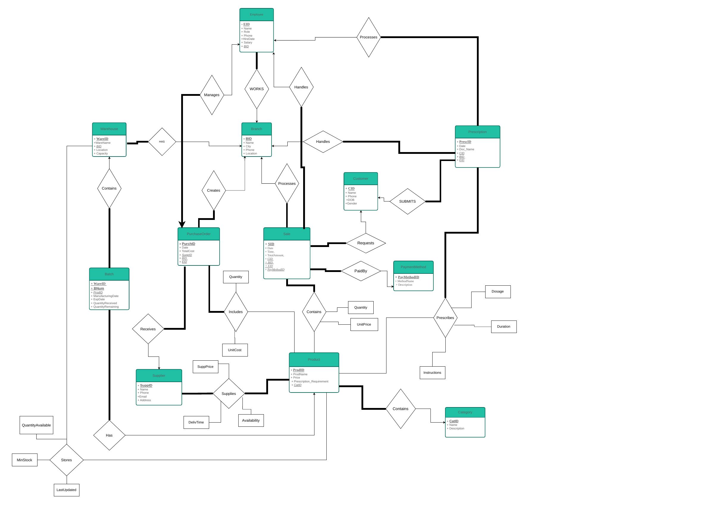

<p align="center">
  
</p>

# GrandPharm Pharmacy Management System

A JavaFX desktop application backed by a MySQL relational database for managing pharmacy products, inventory, sales, purchases, prescriptions, and reports.

Built as a **COMP333 Databases** course project by **Omar Shoubaki** and **Mohammad Majadleh**.

## Application preview

### Dashboard

Product, employee, customer, and sales totals, stock and expiry alerts, quick access to modules, and recent transactions.



### Reports and analytics

Sales revenue, items sold, top branch, and charts for comparing business activity.



Screenshots were captured from the existing application connected to its local database. The included seed script is a separate sample dataset, so totals can differ after a fresh import.

## Features

- **Products and inventory:** product records, warehouse stock levels, minimum stock, batch quantities, and expiration dates.
- **Sales:** transactions, line items, customers, employees, branches, and payment methods.
- **Purchases:** supplier purchase orders and order items.
- **Prescriptions:** prescription records and medicine details, including dosage, duration, and instructions.
- **People and suppliers:** customer, employee, and supplier management screens.
- **Reports:** revenue by branch, top-selling products, sales trends, payment methods, inventory categories, employee revenue, supplier purchases, and monthly prescriptions.

## Technology

| Component | Technology |
| --- | --- |
| Application | Java 21 |
| Desktop interface | JavaFX 21; development SDK 21.0.11 |
| Database | MySQL |
| Database access | JDBC and MySQL Connector/J; development driver 9.7.0 |
| IDE | Eclipse |

## Project structure

```text
grandpharm-pharmacy-management/
├── src/
│   ├── DAO/                  # JDBC connection and database operations
│   ├── FX/                   # JavaFX screens, UI helper, logo, and CSS
│   └── Tables/               # Data model classes
├── database/
│   ├── schema.sql            # Final definitions for all 17 tables
│   ├── seed/dummydata.sql    # Sample records
│   ├── queries/testing.sql   # SELECT queries and joins
│   └── original/             # Original schema file, including revisions
├── docs/
│   ├── report/               # Original project report
│   ├── diagrams/             # ER diagram in PDF and PNG formats
│   ├── screenshots/          # Application screenshots used above
│   └── PACKAGING-NOTES.md    # Source mapping and preparation changes
├── lib/                      # Local JDBC driver; see lib/README.md
├── .project                  # Eclipse project definition
├── .classpath                # Portable JDBC JAR reference
└── README.md
```

The Java package names and resource locations are preserved so existing imports and JavaFX resource loading continue to work.

## Database design

The schema contains 17 tables covering branches, warehouses, employees, customers, suppliers, categories, products, payment methods, sales, purchases, prescriptions, stock, batches, and their item or supplier relationships.

[](docs/diagrams/er-diagram.pdf)

[Open the ER diagram PDF](docs/diagrams/er-diagram.pdf) · [Read the project report](docs/report/project-report.pdf)

The diagram shows the original conceptual design. Use `database/schema.sql` for the implemented column names, junction tables, and constraints.

## Run locally

### 1. Prepare dependencies

Install a JDK 21, the JavaFX 21 SDK for your operating system, a MySQL server, and MySQL Connector/J. The SDK and JDBC driver are local dependencies and are excluded from this package.

Copy the JDBC driver to `lib/mysql-connector-j.jar`. See [lib/README.md](lib/README.md) for the expected filename.

### 2. Create and populate the database

Use a new, empty database named `grandpharm`. From a MySQL client, create it:

```sql
CREATE DATABASE grandpharm;
```

Then open and execute these scripts in order in MySQL Workbench or another MySQL client:

1. [`database/schema.sql`](database/schema.sql)
2. [`database/seed/dummydata.sql`](database/seed/dummydata.sql)
3. Optionally, [`database/queries/testing.sql`](database/queries/testing.sql) to inspect records and joins.

`schema.sql` contains the final table definitions extracted from the original file. The file in `database/original/` preserves earlier revisions and includes `DROP TABLE` statements; it is retained as an archive rather than the normal setup entry point. Import the seed data once into empty tables.

### 3. Configure the connection

Edit [`src/DAO/DBConnection.java`](src/DAO/DBConnection.java) for your local MySQL instance:

```java
private static final String URL = "jdbc:mysql://localhost:3306/grandpharm";
private static final String USER = "root";
private static final String PASSWORD = "YOUR_MYSQL_PASSWORD";
```

The password in this package is a placeholder. Set a local value to run the application and restore the placeholder before sharing or committing the source.

### 4. Launch from Eclipse

1. Import this folder with **File → Import → General → Existing Projects into Workspace**. The original Eclipse project name is `Base`.
2. Select a JDK 21 for the project.
3. Define a Java user library named **JavaFX21** and add the JARs from your JavaFX SDK's `lib` folder. The project already references this library.
4. Confirm `lib/mysql-connector-j.jar` is present on the classpath.
5. Open **Run Configurations → Java Application** and select main class **`FX.Dashboard`**.
6. Add these VM arguments, replacing the example path with your JavaFX SDK location:

   ```text
   --module-path "C:\path\to\javafx-sdk-21\lib" --add-modules javafx.controls
   ```

7. Run the application with MySQL available.

### Compile from PowerShell

Run this from the project folder, replacing the JavaFX path first:

```powershell
$javafxLib = 'C:\path\to\javafx-sdk-21\lib'
New-Item -ItemType Directory -Path build/classes -Force | Out-Null
$javaSources = Get-ChildItem src -Recurse -Filter *.java | ForEach-Object FullName
javac -encoding UTF-8 --release 21 --module-path $javafxLib --add-modules javafx.controls -d build/classes $javaSources
Copy-Item src/FX/logo.png, src/FX/charts.css -Destination build/classes/FX/
java --module-path $javafxLib --add-modules javafx.controls -cp "build/classes;lib/mysql-connector-j.jar" FX.Dashboard
```

The logo and stylesheet must be copied beside the compiled `FX` classes, as shown above. Other operating systems use `:` instead of `;` as the classpath separator.

## Preparation notes

The source package was compiled successfully using JDK 21 and JavaFX 21.0.11. The existing application was opened for dashboard and reports screenshots. The extracted schema and seed scripts were not imported into a new database during packaging.

See [packaging notes](docs/PACKAGING-NOTES.md) for copied filenames and the small portability changes made to this copy. No Git repository, commits, or remote publication were created during preparation.
